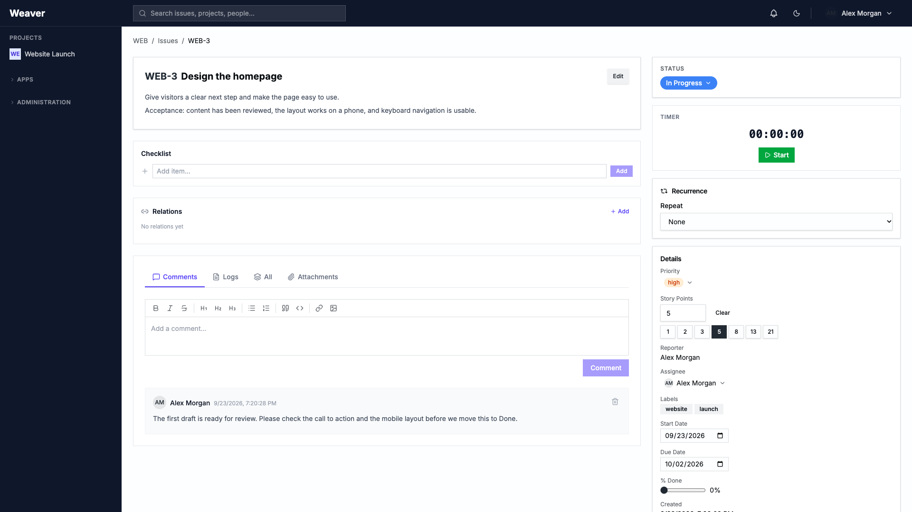
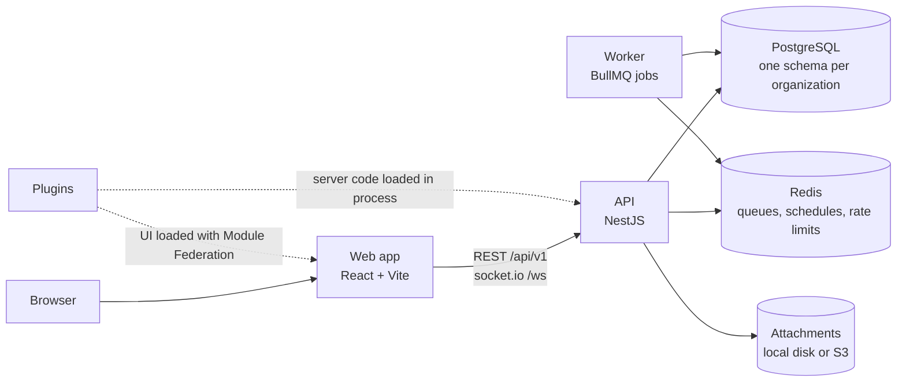

# Weaver

Weaver is open-source project management software that you run on your own server. Teams track work as issues, move it across boards, plan sprints and roadmaps, and keep project documentation next to the work. Clients can join a project to file requests and reply, and people without an account can send requests through a public form.

Weaver is free under the [MIT license](LICENSE). There is no hosted version: your team, or someone you trust, runs it, and your data stays in your own database.



| If you... | Start here |
| --- | --- |
| were invited to a project by a team | [Weaver for invited clients](docs/wiki/For-Invited-Clients.md) |
| are deciding whether Weaver fits your team | [What Weaver does](#what-weaver-does) and [Before you choose Weaver](#before-you-choose-weaver) |
| want to run Weaver, build a plugin, or work on the code | [For developers and operators](#for-developers-and-operators) |

## What Weaver does

Everything in Weaver starts with an issue: one piece of work, such as a task, a bug, or a client request. Issues live in projects, and projects belong to your organization.

### Track the work

- Give each issue a summary and a formatted description, then add priority, labels, story points, start and due dates, percent done, and attachments. Paste or drop images straight into the text.
- Discuss work in comments. Type `@` to mention someone and they get a notification.
- Set an issue to repeat daily, weekly, or monthly.
- See every change in the issue's activity history.
- Add checklists, links between issues (blocks, duplicates, causes, clones), and a start-and-stop timer with optional plugins.

### See the work your way

- **List:** sort, page through, and edit fields in place. Select several issues to change their status, assignee, priority, or sprint at once.
- **Board:** drag cards between status columns. Group them into swimlanes by assignee, priority, or epic, and set work-in-progress limits that warn you when a column gets too full.
- **Backlog and sprints:** plan each sprint against a story-point capacity, then start and complete it. Burndown, sprint summary, and velocity charts show how it went.
- **Roadmap:** see epics and their progress on a month or quarter timeline. Drag the end of a bar to change its dates.
- **Gantt and calendar:** see dated work across time or by due date.
- **Search:** type a query such as `priority = "high" AND label = "bug"` and save the ones you reuse.

### Work with clients and the public

- Invite people with a private link. An administrator enters the person's email address and a role (member or viewer), then sends them the link Weaver creates. It works once, only for that address, and expires after seven days.
- Clients with the member or viewer role see a private project only after you add them to it, and they see only the people who share a project with them.
- Collect requests with intake forms. Share a link, embed the form on your website, or print its QR code. Each submission becomes an issue, and a hidden spam trap, optional reCAPTCHA, and a rate limit keep junk out.
- Make a project public to share a read-only view of its issues and board.

### Keep people informed

- A notification bell collects mentions, new form submissions, and alerts from automation rules.
- Once an administrator connects a mail server, Weaver emails people about assignments, status changes, comments, and mentions. Everyone chooses which emails they get, and each email has an unsubscribe link.

### Write it down

- Each project has its own wiki. Nest pages, search them, and restore any earlier version. Pages save as you type.

### Automate the routine

- Build rules in four steps: pick what starts the rule, set conditions, choose actions, and review. Rules can start when an issue is created, updated, moved to a new status, or assigned, when someone comments, when a sprint starts or ends, or on a schedule.
- Actions set a field, move an issue to another status, add a label or comment, notify someone, or call another system through a webhook.
- Each rule keeps a log of its runs.

### Track time

- Log time on an issue by hand or with the timer, then report it by project, person, or issue and export it as CSV.
- Automatic Time (alpha, macOS only): a menu-bar app drafts your time from what you work on. Nothing becomes official until you review and release it, and the raw activity stays on your Mac.

### Connect other tools

- Import projects from Jira Cloud or Jira Server/Data Center, including issues, comments, attachments, sprints, statuses, and issue types.
- Import and export a project's issues as CSV or JSON.
- Create personal API keys with read, write, or admin scope for scripts and other systems.
- Send webhooks to other systems when issues, comments, or sprints change.

### Stay in control

- Organization roles (owner, admin, member, viewer, and custom roles you define) decide what people can do. Project roles (lead, member, viewer) decide what each person can do inside a project.
- Administrators draw the workflow on a visual canvas: the statuses, and which moves between them are allowed.
- An audit log records changes to projects, workflows, roles, plugins, settings, and more, with before and after values, filters, and CSV export.
- Sign in with email and password, Google, or GitHub. An organization can also set up SAML or OIDC single sign-on.
- Press `?` to see keyboard shortcuts. Switch between light and dark themes from the header.

## If a team invited you

You don't need to install anything. Open the invitation link from your team, enter your name and a password, and open your project. From there you can create issues, reply in comments, and attach screenshots or documents. Short help is built into the issue screens, and the [invited-client guide](docs/wiki/For-Invited-Clients.md) walks through each step with pictures.

If you normally sign in with Google or GitHub and have no Weaver password, ask your team before you accept. The invitation form asks for a password.

## Before you choose Weaver

- **Someone has to run it.** Weaver needs a server or cloud account with Docker, PostgreSQL, and Redis, and a person comfortable maintaining them. There is no hosted version to sign up for.
- **It is young.** Its packages are still at version 0.0.x, and its first release was readied for a client pilot in October 2026. Read the [current limits](#current-limits) before you move a team over.
- **There is no "forgot password" email yet.**
- **It is built for desktop browsers.** Joining, creating an issue, and replying are tested on a phone-sized screen; other screens are less polished there.
- **It is in English only.**
- **Some integrations are partial.** The GitHub, GitLab, and Bitbucket plugins record which commits and pull requests mention an issue, but no screen shows those links yet. Jira import leaves out issue links, epic links, and worklogs.

## User guides

| Topic | Guide |
| --- | --- |
| Joining a project as a client | [Weaver for invited clients](docs/wiki/For-Invited-Clients.md) |
| Setting up an organization and first project | [Getting Started](docs/wiki/Getting-Started.md) |
| Who can see and change what | [Projects and Access](docs/wiki/Projects-and-Access.md) |
| Issues, editing, attachments, and bulk changes | [Working with Issues](docs/wiki/Working-with-Issues.md) |
| Boards, swimlanes, and WIP limits | [Boards and Views](docs/wiki/Boards-and-Views.md) |
| Sprints and reports | [Sprints and Reports](docs/wiki/Sprints-and-Reports.md) |
| Roadmaps and epics | [Roadmaps and Epics](docs/wiki/Roadmaps-and-Epics.md) |
| Comments, mentions, and notifications | [Collaboration and Notifications](docs/wiki/Collaboration-and-Notifications.md) |
| Keyboard shortcuts | [Keyboard Shortcuts](docs/wiki/Keyboard-Shortcuts.md) |
| Automation rules | [Automations](docs/wiki/Automations.md) |
| Repeating issues | [Recurring Tasks](docs/wiki/Recurring-Tasks.md) |
| Project wiki | [Project Wiki](docs/wiki/Project-Wiki.md) |
| Intake forms | [Intake Forms](docs/wiki/Intake-Forms.md) |
| Moving from Jira | [Jira Import](docs/wiki/Jira-Import.md) |
| API keys and webhooks | [API Keys and Integrations](docs/wiki/API-Keys-and-Integrations.md) |
| Plugins | [Plugins](docs/wiki/Plugins.md) |
| Automatic Time | [Automatic Time](docs/wiki/Automatic-Time.md) |
| Google, GitHub, SAML, and OIDC sign-in | [OAuth Sign In](docs/wiki/OAuth-Sign-In.md) |
| Audit log | [Audit Log](docs/wiki/Audit-Log.md) |
| Something isn't working | [Troubleshooting](docs/wiki/Troubleshooting.md) |

The [documentation index](docs/README.md) explains how these guides are maintained. A published copy lives on the [project wiki](https://github.com/jakwinkler/weaver/wiki) and can lag behind this folder.

---

## For developers and operators

### How it fits together

Weaver is a TypeScript monorepo with three processes and two data services.



| Part | Responsibility |
| --- | --- |
| `apps/web` | React single-page app. Hosts plugin UIs through Module Federation. |
| `apps/api` | REST API under `/api/v1`, socket.io gateway on `/ws`, authentication, tenancy, and plugin loading. Also runs automation rules, the daily recurring-issue scan, audit-log retention, and attachment cleanup. |
| `apps/worker` | Sends email over SMTP, delivers outbound webhooks with retries, runs Jira imports, and hands scheduled automations back to the API. |
| PostgreSQL 16 | Identity and installation records in the `public` schema; each organization's data in its own `tenant_<slug>` schema. |
| Redis 7 | BullMQ queues, cron schedules, and rate-limit counters. Rate limiting fails closed, so the API returns 503 while Redis is unavailable. |

### Tech stack

- **Monorepo:** pnpm workspaces and Turborepo, TypeScript throughout, Node.js 22.
- **API:** NestJS 10, TypeORM 0.3, BullMQ 5, socket.io 4, zod.
- **Web:** React 18, Vite 6, React Router 7, TanStack Query 5, Zustand 5, Tailwind CSS 4, Radix UI, Tiptap 3, dnd-kit, React Flow 12, Recharts 3.
- **Plugins:** Module Federation (`@module-federation/vite` and the enhanced runtime).
- **Tests:** Jest for the API and packages, Vitest for the web app and worker, Playwright for the browser suite.
- **Automatic Time companion:** Swift, macOS 13 or later.

### Run it locally

You need Node.js 22, pnpm 9.15.4 (Corepack provides it), and Docker with Compose. Ports 3000, 5173, 5432, 6380, and 5181 to 5189 must be free.

```sh
corepack enable
pnpm install --frozen-lockfile
cp .env.example .env
docker compose --env-file .env -f docker/docker-compose.dev.yml up -d
pnpm build
pnpm dev
```

Open http://localhost:5173/register and create an organization. The first account becomes its owner, and the organization starts with a default workflow (To Do, In Progress, Done) and the standard issue types. There is no seed data or default administrator.

Board, backlog, sprint, Gantt, and calendar views come from plugins. Install the ones you want under **Administration → Plugins**. In development every plugin in `plugins/` is available.

`pnpm dev` starts:

- the API on http://localhost:3000, with a health check at `/api/v1/health`
- the web app on http://localhost:5173, which proxies `/api` and `/socket.io` to the API
- the worker
- Vite dev servers for plugin UIs on ports 5181 to 5189, each of which exits if its port is taken

Things that trip people up:

- Run `pnpm build` before `pnpm dev`. Shared packages resolve to their `dist/` output, and the API serves plugin bundles from `plugins/*/dist`.
- The dev Compose file hard-codes the PostgreSQL user, password, and database name to match `.env.example`. Change both together.
- Development mode lets TypeORM synchronize the schema automatically. Point it only at a disposable database.
- The worker doesn't read `.env`. Its defaults match the dev Compose services, which is enough for a first run. To test email or Jira import, start the API and web app separately (`pnpm --filter @weaver/api dev` and `pnpm --filter @weaver/web dev`) and run the built worker with `node --env-file=.env apps/worker/dist/main.js`.
- `VITE_` variables are compiled into the browser bundle. Never put secrets in them.

### Configuration

The root [`.env.example`](.env.example) covers local development. Production starts from [`deploy/compose/.env.example`](deploy/compose/.env.example). The main settings:

| Setting | Purpose |
| --- | --- |
| `DATABASE_HOST`, `DATABASE_PORT`, `DATABASE_USER`, `DATABASE_PASSWORD`, `DATABASE_NAME` | PostgreSQL connection |
| `REDIS_HOST`, `REDIS_PORT`, `REDIS_PASSWORD` | Redis connection. The dev default port is 6380. |
| `JWT_SECRET`, `JWT_REFRESH_SECRET` | Session signing. Required; use two different random values. |
| `API_PUBLIC_URL`, `API_PREFIX`, `WEB_URL`, `WEB_APP_URL`, `CORS_ORIGINS`, `TRUST_PROXY` | Public URLs and reverse-proxy behavior |
| `STORAGE_DRIVER` (`local` or `s3`), `STORAGE_LOCAL_PATH`, `S3_*`, `ATTACHMENT_MAX_BYTES` | Attachment storage. The default size limit is 10 MiB. |
| `SMTP_*` | Fallback mail server. Each organization can also set its own under System Settings. |
| `GOOGLE_CLIENT_ID`, `GOOGLE_CLIENT_SECRET`, `GITHUB_CLIENT_ID`, `GITHUB_CLIENT_SECRET` | Google and GitHub sign-in |
| `IMPORT_CREDENTIAL_KEY` | Encrypts Jira credentials inside import jobs: 32 random bytes, base64-encoded. The API and worker need the same value. |
| `WEAVER_TRUSTED_PLUGINS` | Comma-separated plugin IDs, such as `@weaver/plugin-board`, allowed to load in production |
| `ALLOW_TENANT_SCHEMA_BOOTSTRAP` | Lets production create new organizations and their schemas |
| `RECAPTCHA_SITE_KEY`, `RECAPTCHA_SECRET_KEY` | Optional reCAPTCHA for public forms |
| `AUDIT_LOG_RETENTION_DAYS` | How long audit entries are kept |

In production the API refuses to start without explicit JWT secrets, or with the development database and Redis passwords.

### Tests and CI

```sh
pnpm lint
pnpm turbo typecheck
pnpm test
```

The API integration tests and the Playwright browser suite need disposable PostgreSQL and Redis services and a database whose name starts with `weaver_e2e`. [`apps/web/e2e/README.md`](apps/web/e2e/README.md) has the exact commands. The [October 14 readiness record](apps/web/e2e/READINESS-2026-10-14.md) lists the runs behind the pilot release.

CI runs on every push and pull request to `main`: lint and typecheck, unit tests, API integration tests against PostgreSQL and Redis, a full build, and Docker image builds. Separate workflows run Gitleaks secret scanning across the full history and a weekly `pnpm audit` of production dependencies. The Playwright suite runs locally, not in CI.

### Deploy

[`deploy/compose`](deploy/compose/README.md) is the maintained deployment template. It runs the API, worker, web server, PostgreSQL, and Redis, and publishes only the web server, on a loopback port behind your HTTPS reverse proxy. It is a building block, not a one-command installer. Before the first start:

- **Plan the database.** Production turns off automatic schema changes. `schema-plan.cjs` writes a read-only plan for you to review, and `apply-schema-plan.cjs` applies only that reviewed plan. Installations without schema synchronization also need [`packages/db/migrations/20261014_organization_invitations.sql`](packages/db/migrations/20261014_organization_invitations.sql) before invitations work.
- **List the plugins you trust** in `WEAVER_TRUSTED_PLUGINS`. Production loads none by default, which also hides the board, backlog, sprint, Gantt, and calendar views.
- **Decide how organizations get created.** Production refuses to create new organizations unless `ALLOW_TENANT_SCHEMA_BOOTSTRAP=true`. Read the [September rollout notes](docs/security/review-2026-09-23-rollout.md) before turning it on.
- **Configure mail.** The template doesn't pass `SMTP_*` to the worker, so set the mail server for each organization under **System Settings → Email**.
- **Keep `IMPORT_CREDENTIAL_KEY` identical** for the API and worker if you use Jira import.
- **Back up together:** PostgreSQL, the uploads volume, your protected env file, and the image references. Rehearse a restore.

After a deploy, check more than the health endpoint. `GET /api/v1/health` returns a static OK and doesn't touch PostgreSQL or Redis, so also test sign-in, a file upload, the plugin screens, and any background jobs you rely on.

Other deployment material gets less attention:

- `docker/docker-compose.yml` and `docker/Dockerfile.*` are an older all-in-one stack. CI builds these images, but no guide covers the Compose file.
- `k8s/base`, `k8s/overlays`, and `k8s/helm/weaver` are Kustomize and Helm starting points with placeholder hosts. The Helm chart needs external PostgreSQL and Redis and a ReadWriteMany volume. socket.io has no Redis adapter yet, so multiple API replicas don't share live events.

### Plugins

Plugins add project views, issue panels, full pages, server routes, and integrations. An administrator installs each one for the organization, and project views can be switched on or off per project.

- The API scans `plugins/` (or `WEAVER_PLUGINS_DIR`) for `weaver-plugin.json` manifests, validates them, and loads server code into the API process. Plugin routes are served under `/api/v1/plugin-routes/`.
- Plugin UIs are Module Federation remotes loaded at runtime from `/plugin-assets/`. They can add content to the issue page and its sidebar, sidebar navigation, full pages under `/apps/`, and project view tabs.
- Server code gets a tenant-scoped database handle, an HTTP client that blocks private addresses, events, settings, logging, and APIs for issues, projects, custom fields, activity, and time entries.
- When a newer plugin version starts, Weaver runs its versioned migrations and `onUpgrade` hook before recording the new version. Downgrades are refused.
- Plugins are trusted code. Server code runs inside the API with the shared database role, and UI code runs with the viewer's session. Install only plugins you have reviewed.

| Bundled plugin | What it adds | Notes |
| --- | --- | --- |
| Kanban Board, Sprints, Gantt Chart, Calendar, Time Tracking | Board, backlog and sprint, Gantt, calendar, and time-log views | Switches for views built into the core app. Switched on for every new project once installed. |
| Checklist | A checklist on each issue | Can update the issue's percent done |
| Issue Relations | Links such as blocks, duplicates, causes, and clones | |
| Issue Timer | A start, pause, and stop timer on each issue | Saves a time entry when stopped |
| Time Reports | Time by project, person, or issue, with CSV export and saved reports | |
| Automatic Time | Private time drafts from the macOS companion, reviewed and released by each person | Alpha. Installs disabled. Uninstalling deletes its private data and keeps official time. |
| GitHub, GitLab, and Bitbucket Integration | Signed webhooks that record commits and pull or merge requests mentioning an issue key | Server only; the issue panels are placeholders |
| Repository Integration | An API and custom fields for linking repositories to projects | Server only, no UI |
| Plugin Template | A minimal example plugin | A starting point for your own |

To build your own, use the `weaver` CLI. It isn't published to npm yet, so run it from this repository after `pnpm build`:

```sh
node packages/cli/bin/weaver.js create-plugin release-notes --directory plugins
```

That scaffolds a manifest, server handlers, and a client entry. `weaver validate`, `weaver dev`, and `weaver build` check it, serve it with hot reload, and build its bundle. The [plugin development guide](docs/plugin-development.md), [plugin API reference](docs/plugin-api-reference.md), and [manifest reference](docs/plugin-manifest-reference.md) cover the details. `PLUGIN.md` predates the CLI and describes registries that no longer exist.

### Repository layout

```text
apps/
  api/                         NestJS API
  web/                         React app and plugin host
  worker/                      BullMQ job processors
packages/
  db/                          TypeORM entities and SQL migrations
  shared/                      Types, constants, and zod schemas used by the API and web app
  server-common/               Outbound HTTP guard, storage, sealed jobs, runtime checks
  sdk/                         Plugin SDK
  cli/                         Plugin CLI (create-plugin, dev, build, validate)
  jira-import/                 Jira client, field mapping, and import orchestration
  automatic-time-evaluation/   Synthetic fixtures for scoring Automatic Time
  config/                      Shared ESLint and TypeScript configuration
  ui/                          Shared component kit, not yet used by the web app
plugins/                       Bundled plugins
companion/automatic-time-macos/  Swift menu-bar companion for Automatic Time
deploy/compose/                Production Compose template and schema scripts
docker/                        Dockerfiles, nginx config, dev and all-in-one Compose files
k8s/                           Kustomize base, overlays, and Helm chart
docs/                          User guides, plugin references, architecture decisions, security notes, roadmap
spikes/                        Early feasibility experiments
```

### Current limits

These are known gaps in this release:

- No password reset or email verification.
- The sign-in page shows only Google and GitHub buttons. SAML and OIDC sign-in start from `/api/v1/auth/saml/<organization-slug>` and `/api/v1/auth/oidc/<organization-slug>`.
- Live updates reach project pages and issue pages, but not the dashboard or search.
- Administrators can define custom fields, and forms or the API can fill them, but the issue page doesn't show or edit their values.
- Board cards and the backlog's assignee filter show a short user ID instead of a name.
- The workflow editor saves its diagram layout in each administrator's browser, not on the server.
- The header search returns issues only.
- Teams are named groups; nothing else uses them yet.
- Organization mail and SSO secrets, webhook secrets, and plugin settings are stored unencrypted in PostgreSQL. API responses mask them, so protect database access and backups.
- There is no OpenAPI description. The [developer reference](docs/wiki/Developer-Reference.md) and the controllers in `apps/api/src` document the API.

### Project history

- [`docs/roadmap`](docs/roadmap/README.md) holds planning history. Its checkboxes and "current state" notes are not release status.
- [Feature coverage](docs/wiki/Feature-Coverage.md) maps each of the 29 roadmap items to a guide and records what was checked.
- `PROGRESS.md`, `plan.md`, `SCAN.md`, and the `REVIEW-*-RESOLUTION.md` files are historical records.

### Security

- Each organization's data lives in its own PostgreSQL schema, and every request checks organization membership and project access.
- API keys and refresh tokens are stored as hashes. Jira credentials are encrypted inside import jobs.
- Outbound requests from webhooks, mail settings, OIDC discovery, and plugins block private and reserved addresses.
- Requests are rate limited through Redis, and the API sends a strict Content Security Policy.
- CI scans the full Git history for secrets. See [repository hygiene](docs/security/repository-hygiene.md), the [project directory privacy policy](docs/security/project-directory-privacy.md), and the [Automatic Time threat model](docs/security/automatic-time-threat-model.md).

To report a vulnerability, use [GitHub private vulnerability reporting](https://github.com/jakwinkler/weaver/security/advisories/new) (**Security → Report a vulnerability** on this repository). Please don't open a public issue.

### License

Weaver is released under the [MIT license](LICENSE).
