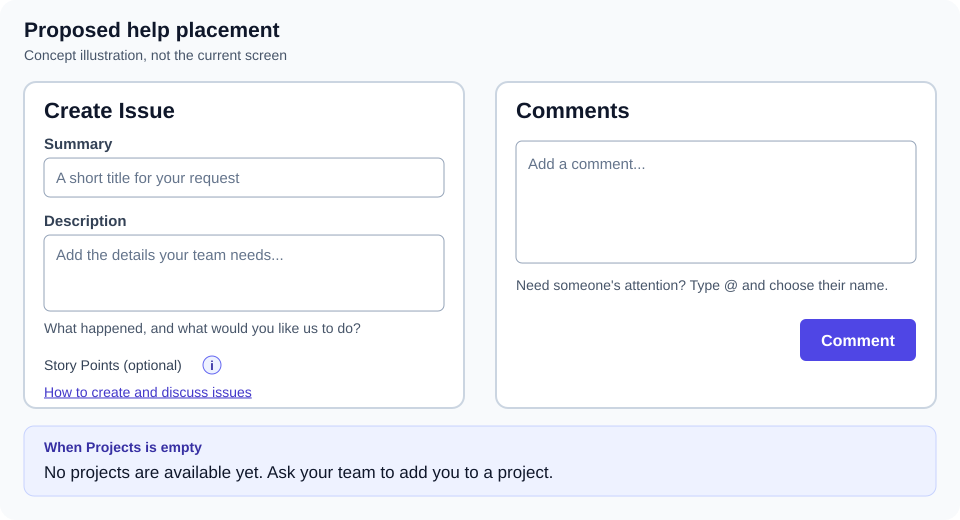

# Inline help for invited clients

Implementation and local verification, October 15, 2026. The frontend extends pilot baseline `ce5494a`. Deployment is recorded separately in the release metadata.

## Recommendation

Use short, visible guidance at the few points where a client can get stuck. Keep tooltips for optional terms such as **Story Points**. A tooltip should never be the only way to learn how to create an issue or reply, because it is easy to miss on a phone or with a keyboard.

The target is the invited organization member who has been added to an existing project as a project member. Weaver has no separate `client` role; use the current permission and project-access checks when showing actions or help.

## Starting point at pilot release ce5494a

- A client with no visible projects sees “No projects yet. Create your first project to get started,” even when they cannot create one. The useful next step is to ask the team for project access.
- **Create Issue** has a summary and optional planning fields but no description input. The API already accepts a description during creation. The client must otherwise open the new issue and find the description editor.
- The description's pencil button appears on hover. That makes the next step hard to discover on a phone and for keyboard users.
- The **Comments** editor already has a clear action and preserves unfinished text in the same browser. It needs at most a short hint about `@` mentions.
- An existing account that has only used external sign-in cannot accept the current invitation form, because it requires that account's password. Inline wording should direct that person to the team; supporting external-only accounts needs a separate invitation-flow change.

## Implemented changes



*Original placement concept. The client guide now includes screenshots from the working implementation.*

1. The empty **Projects** state uses the user's create permission. Someone who cannot create projects sees “No projects are available yet. Ask your team to add you to a project.”
2. **Create Issue** now leads with Summary and Description. The visible prompt asks “What happened, and what would you like us to do?” Description uses the existing rich text format and API field. Failed requests preserve the text; successful creation clears the form. Files are added through Attachments after creation so they belong to an existing issue.
3. **Add details** and **Edit description** are visible buttons. The detail layout stacks on phones so the description and conversation remain usable.
4. **How to create and discuss issues** expands a short guide inside the app, beside creation and Comments. Its instructions respect the current permissions. It does not depend on an unpublished wiki URL.
5. Comments shows “Need someone's attention? Type @ and choose their name.” Optional fields sit under **More options (optional)**, with tooltips for Type, Priority, Story Points, Start Date, Due Date, and Repeat. Help opens on focus, hover, or tap and closes with Escape, another tap, or an outside action.

The invitation password hint also directs people who only use a sign-in button to their team. Supporting those accounts during invitation acceptance still requires a separate authentication change.

## Review and acceptance

Local checks use disposable PostgreSQL and Redis containers, a local API on port 3302, and the changed frontend on port 5174. No existing Weaver database is used.

- 22 component tests pass across issue creation, issue details, comments, project empty states, recurrence, and rich text rendering. The new empty-state, description-field, visible-action, and viewer-shortcut assertions failed before implementation.
- 9 Chromium scenarios pass, including invited clients on desktop and a phone, description persistence through reload, failed-create text preservation, optional-field help by keyboard and touch, replies through reload, and viewer controls. Existing issue and mobile flows are included.
- `pnpm --filter @weaver/web build` passes. The existing large-bundle warning remains.
- Desktop and phone screenshots were inspected and the client guide's creation and reply visuals were refreshed with fictional data.

The create shortcut waits for permissions before opening the form. Its invited-client browser check reproduced an early-clear failure before that fix. Temporary test services were removed after verification.

The browser command is:

```sh
PLAYWRIGHT_BASE_URL=http://127.0.0.1:5174 PLAYWRIGHT_API_URL=http://127.0.0.1:3302/api/v1 \
  pnpm --filter @weaver/web exec playwright test \
  e2e/client-help.spec.ts e2e/issues.spec.ts e2e/mobile.spec.ts
```

Accessible names and helper associations are checked in the browser. This is not a full assistive-technology audit. Publishing the guide and deploying the UI are separate approvals.

Source reviewed for this plan: pilot release `ce5494a`, especially `ProjectsPage.tsx`, `IssueListPage.tsx`, `IssueDetailPage.tsx`, `CommentsSection.tsx`, and `createIssueSchema`.
