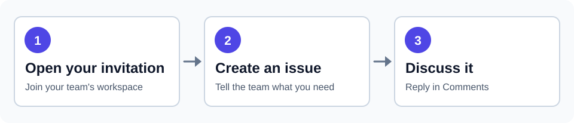
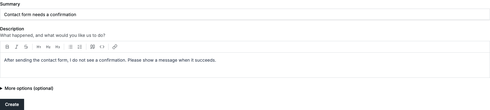
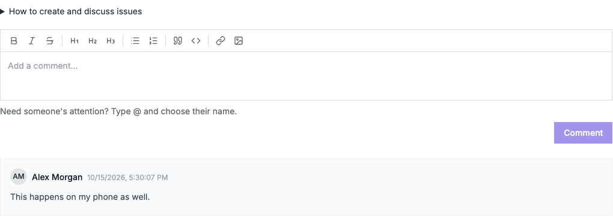

# Weaver for invited clients

Your project team will send you a private invitation link and add you to a project. Use Weaver to share requests and keep the conversation with each issue.

## Join and find your project

1. Open the invitation link your team sent you. Check the organization name and invited email address.
2. Enter your name and a password, then choose **Join organization**. If you already sign in to Weaver with a password, use that password. If you forgot it, choose **Forgot password?** on the sign-in page first.
3. Open your project from **Projects**. If you belong to more than one organization, use your account menu to switch to the right one.

An invitation can only be used once and expires after seven days. If the link has expired or no longer works, ask the sender for a new one. A team can cancel a link or replace it with a newer one. If you joined but cannot see the project, ask the team to add you to that project.

If you already use Google or another sign-in method and do not have a Weaver password, contact the team before accepting the link. The current invitation form requires a password.

## Create an issue

Open the project, choose **Issues**, then **Create Issue**. Write a short **Summary** that says what you need, such as “Contact form does not send a confirmation.” In **Description**, explain what happened, what you expected, and anything the team needs to reproduce the request.

Leave **More options (optional)** as they are unless your team has asked you to use them. The question-mark buttons explain those fields. Choose **Create**, then open your issue from the list.

To change the description later, choose **Edit description**, or **Add details** if it is empty. Choose **Save** when you are finished.

## Reply to an issue

Open the issue and choose **Comments**. Write your answer in **Add a comment...**, then choose **Comment**. Your reply appears below the editor. If you need a specific person to see it, type `@` and select their name from the suggestions.

To add a screenshot or document, open **Attachments** and use **browse** or drop the file there. Check that its filename appears. The notification bell at the top of Weaver helps you return to new activity.

*Examples use fictional data. You can open **How to create and discuss issues** inside Weaver whenever you need a reminder.*
